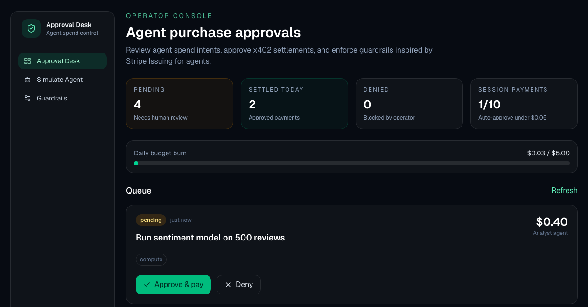
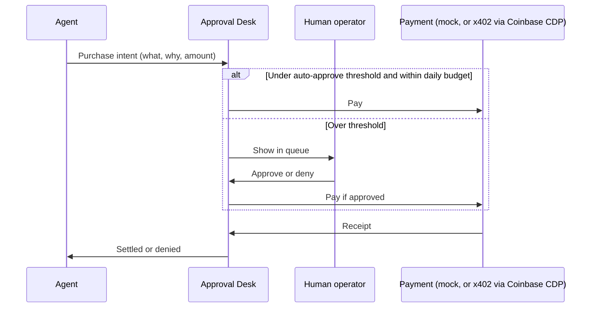

# Agent Approval Desk

Human-in-the-loop console for approving agent purchase intents and settling x402 micropayments. Inspired by **Stripe Link / Issuing for agents** and **Coinbase Agentic Wallets**.



## What it does

- **Approval Desk** — review pending agent spend requests, approve or deny
- **Simulate Agent** — create purchase intents (enrichment, scrape, API calls)
- **Guardrails** — auto-approve under a threshold, daily budget, session payment cap
- **PostHog** — track `intent_created`, `intent_approved`, `intent_denied`, funnels
- **Payments** — mock x402 settlement by default; wire Coinbase CDP for live USDC

## Quick start (local)

```bash
git clone https://github.com/raheeldeal/agent-approval-desk.git
cd agent-approval-desk
npm install
cp .env.example .env.local
npm run dev
```

Open [http://localhost:3000](http://localhost:3000).

### Demo flow

1. Go to **Simulate Agent** → submit a $0.12 enrichment request → appears on desk
2. Go to **Approval Desk** → click **Approve & pay** → receipt appears
3. Submit a $0.03 request → auto-approves if under your threshold ($0.05 default)
4. Open PostHog → watch `intent_approved` events in Live events

## Environment variables

| Variable | Required | Description |
|----------|----------|-------------|
| `NEXT_PUBLIC_POSTHOG_KEY` | Optional | PostHog project API key |
| `MOCK_PAYMENTS` | Optional | `true` (default) = simulated settlement |
| `CDP_API_KEY_ID` | Live payments | Coinbase Developer Platform key |
| `CDP_API_KEY_SECRET` | Live payments | CDP secret |

## PostHog setup

1. Create a free project at [posthog.com](https://posthog.com)
2. Copy the project API key into `.env.local`:
   ```
   NEXT_PUBLIC_POSTHOG_KEY=phc_...
   ```
3. Suggested events to build funnels from:
   - `intent_created` → `intent_approve_clicked` → `intent_approved`
   - `intent_auto_approved` (under threshold)

## Deploy to Vercel (public URL)

```bash
npx vercel --prod
```

Or connect the GitHub repo in the Vercel dashboard for automatic deploys on push.

Add env vars in **Vercel → Project → Settings → Environment Variables**.

## How it works



Data is stored in `data/snapshot.json` locally and in `/tmp` on Vercel.

## Stack

- Next.js 16 (App Router)
- Tailwind CSS
- PostHog (`@posthog/next`)
- AgentCash / x402 (optional live payments)

## License

MIT. See [LICENSE](LICENSE).
